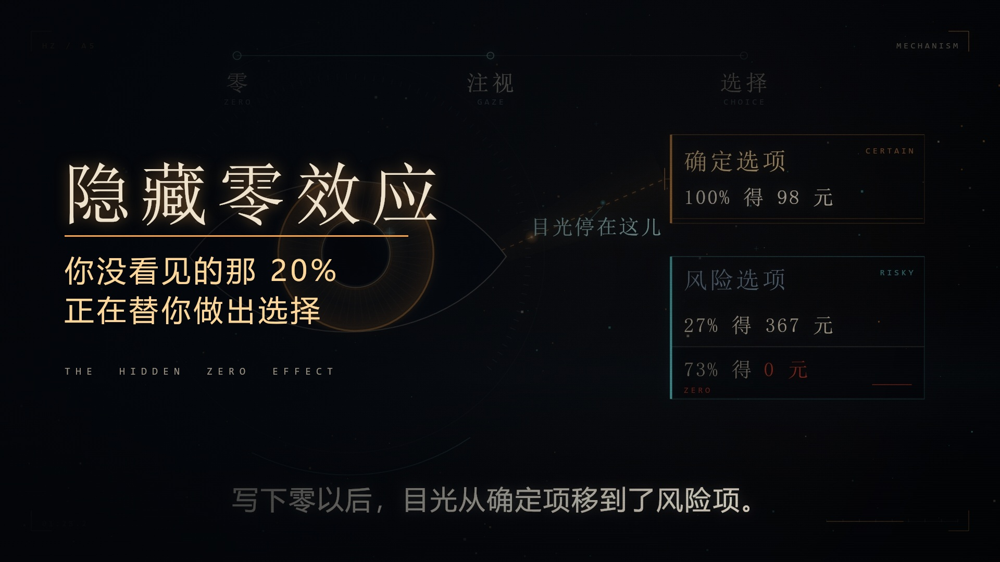

# 隐藏零效应 · The Hidden Zero Effect

一部 **2 分 30 秒、纯代码逐帧生成**的中文科普短片。

主题是认知心理学里的「隐藏零效应」（the hidden-zero effect）：**被省略的那个 0，正在替你做出选择。**

- 成片：B 站（链接待填）
- 规格：**1920×1080 / 30fps / 4512 帧 / 150.4 s**
- 没有 3D、没有素材库、没有 AI 视频、没有配音。**每一帧都是场景代码画出来的。**
- 声音：自备音乐（见「版权」），按节拍裁剪 + 卡点。



---

## 它讲了什么

| 幕 | 时间 | 内容 |
|---|---|---|
| A0 钩子 | 0:00–0:17 | 两个按钮：A 稳拿 100 元，B 80% 拿 100 元。那 20% 是什么？ |
| A1 两个选项 | 0:17–0:31 | 真实实验刺激：100% 得 98 元 vs 27% 得 367 元 |
| A2 隐藏 | 0:31–0:49 | 同一句话的两种写法；**拖动画框边缘，把「0 元」拖进画面** |
| A3 两个方向 | 0:49–1:06 | 2008：显式零 → 更耐心；2026：显式零 → 更冒险 |
| A4 实验 | 1:06–1:23 | N=197、眼动、双条件，柱子在拍点上生长 |
| A5 机制 | 1:23–1:37 | 缺口环张开成一只眼：零 → 注视 → 选择 |
| A6 归零 | 1:37–1:43 | 音乐留白段。零不是没有，是一个有深度的位置 |
| A7 零的发明 | 1:43–1:55 | 巴比伦的空列 → 印度的 bindu → 628 年的运算规则 |
| A8 现实 | 1:55–2:03 | 药效九成 / 年化八点 / 准确率九九，每个都少了一半 |
| A9 看见 | 2:03–2:12 | 框张开，零被放回来，缺口环第一次合拢 |
| A10 升华 | 2:12–2:28 | 一次选择只是无数选择里的一个点；那片点本身就是一个零 |
| Coda | 2:28–2:30 | 片名 + 出处 |

## 科学依据

- Liang, Z.-Y., Guo, M., Xu, Y., Liu, S.-Y., Zhang, L., & Zhou, L. (2026). *Does zero mean nothing? Investigating the attentional mechanism of the hidden-zero effect in risky decision-making.* **Psychonomic Bulletin & Review**, 33, 157–173.
- Magen, E., Dweck, C. S., & Gross, J. J. (2008). *The hidden-zero effect: Representing a single choice as an extended sequence reduces impulsive choice.* **Psychological Science**.

除论文原例（98 元 / 367 元 / 73% / 27%）之外的数字，画面上均标注「示意」。

---

## 怎么做的

**每一帧是虚拟时间 t 的纯函数。** 没有剪辑软件、没有手 K 关键帧、没有不确定性渲染。

```
project.json          规格（设计坐标 1280×720，输出 1920×1080，1.5×）
render.mjs            渲染器：单帧 / 联系表 / 逐帧落盘（可断点续渲）+ 旁白字幕层
src/engine.js         绘制引擎：环境光场、尘埃、确定性噪声、文字、图形、bloom、颗粒、暗角、缺口环母题
src/ui.js             HUD / 侧栏竖排标题 / 尺寸线 / callout / 坐标网格 / 幽灵数字
src/subtitles.json    45 句旁白字幕（时间 + 文本）
src/scenes/*.js       12 个镜头模块，每个导出 { id, start, end, draw(ctx, t, env, p) }
audio/analyze.py      节拍与段落分析（栅格、能量、8 小节段落切点）
build.ps1             一条命令：渲帧 → 编码 → 校验
qc.py / qcframes.py   死帧检测（相邻帧逐像素差）
DESIGN.md             制作规范：调色板 / 字阶 / 构图 / 运动铁律 / 场景 API
```

### 设计约束（写进 DESIGN.md 并执行）

- **调色板只有 6 组色**：近黑蓝底 / 米白文字 / 琥珀暖光 / 青冷光；朱红只用于「缺失」，全片面积 <3%
- **字阶固定**：320 / 220 / 140 / 96 / 64 / 46 / 32 / 22 / 15 / 11
- **禁止死帧**：任何元素静止不超过 0.4 秒；环境光场、尘埃、颗粒是常驻层
- **每 3 秒必须有一个画面状态变化**
- **母题贯穿**：一个带缺口的环，从 A0 的概率饼 → A5 的瞳孔 → A7 的「0」→ A9 合拢 → A10 的星野

### 实测

| 项 | 值 |
|---|---|
| 渲帧 | 4512 帧 / 约 17 分钟（1080p，单进程） |
| 单帧 | ≈ 0.22 s |
| 编码 | H.264 High@4.2, CRF 17, preset medium, aq-mode=3 / 约 5.9 Mbps |
| 运动质检 | 相邻帧逐像素最小差 **0.083**（无任何两帧相同）；差值 <0.10 的最长连续段 **0.13 s** |

---

## 跑起来

```bash
npm install                      # 只依赖 @napi-rs/canvas

# 1) 自备音乐 → audio/bed.wav，然后重建节拍栅格
python audio/analyze.py          # 需要 python3 + numpy
python audio/beat.py             # 产出 audio/grid.json

# 2) 预览
node render.mjs --stills=0,60,120
node render.mjs --contact --keys=64 --cols=8 --tile=200

# 3) 出片
node render.mjs --frames
ffmpeg -framerate 30 -i frames/f%05d.jpg -i audio/bed.wav -c:v libx264 -crf 17 -preset medium -pix_fmt yuv420p -c:a aac -b:a 320k -shortest out/film.mp4
```

Windows 上也可以直接：`powershell -ExecutionPolicy Bypass -File build.ps1`

---

## 版权

- **代码**：MIT，见 LICENSE。
- **本片画面 / 设计文档 / 封面与静帧**：CC BY-NC-SA 4.0（署名 + 非商用 + 相同方式共享）。
- **音乐不在仓库里**。仓库只保留节拍栅格 audio/grid.json（纯时间数据）与分析脚本。想复现请自备。

## 致谢

视觉与工程方法参考了两位作者公开的制作过程（**只学方法，不抄画面**）：
[MisakaZentai/world-execute-me-dsh-pv](https://github.com/MisakaZentai/world-execute-me-dsh-pv)、[yym8224961/world.execute-me-ascii](https://github.com/yym8224961/world.execute-me-ascii)。
